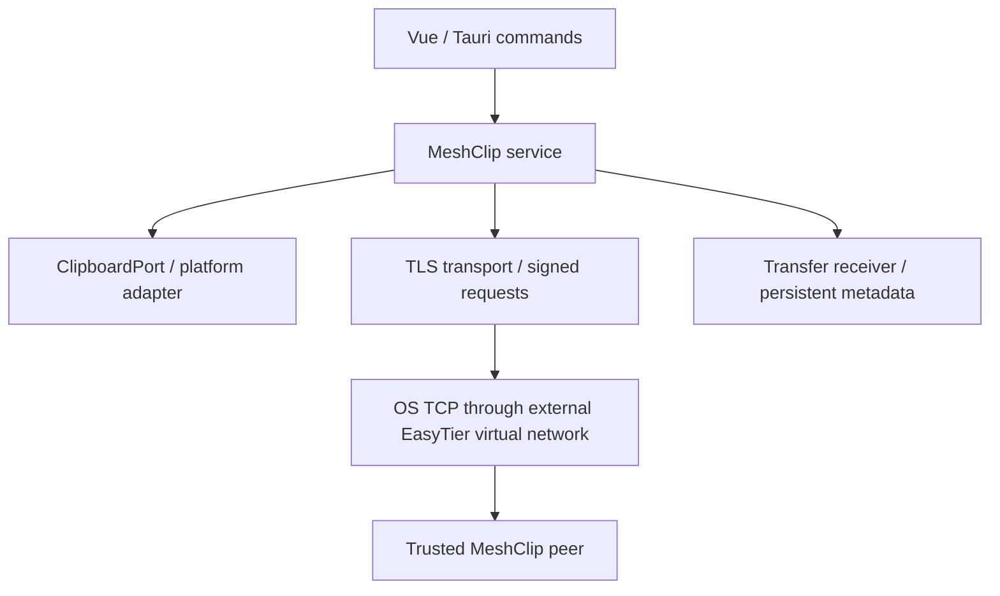

# MeshClip architecture and protocol v1

## Scope and boundaries

One Rust crate currently exposes separate `model`, `service`, `transport`,
`clipboard`, `transfer`, `security`, `storage`, and `platform` modules. This keeps
interfaces inspectable without maintaining eight tiny crate manifests. Tauri
commands are in apps/desktop; Vue never opens a network socket or accesses files
without invoking a backend operation. The dependency direction is UI → service →
modules → OS/network. `NetworkAdapter` provides external-client reachability
probing; no EasyTier management API is integrated. TCP reachability is not proof
of EasyTier membership or MeshClip availability. Authenticated Ping supplies
application availability; EasyTier node state remains unknown.

EasyTier performs VPN, routing and NAT traversal. MeshClip listens only on an
explicit configured address (initially loopback), requires no elevation, and
never launches EasyTier. Configuring a physical/public address is possible;
users should select their EasyTier virtual IP. Wildcard listeners are rejected.
Management RPC and node discovery are intentionally outside this revision.

## Identity and pairing

Each installation generates an Ed25519 signing key and an independent rustls TLS
certificate/key. Device ID is the complete hexadecimal public signing key. On
Windows all identity material is kept in Windows Credential Manager via keyring;
there is no silent plaintext fallback. Other systems currently use a 0600 file
inside a 0700 directory and are development targets only. Certificate rotation
requires revocation and pairing again.

A 120-second single-use invitation exports the recipient's pinned self-signed
certificate, public identity, configured IP/port, and 256-bit CSPRNG token. It
must be transferred through an authenticated private channel. It is a long JSON
invitation, **not a short numeric PAKE code or QR implementation**. Token theft
within its validity allows pairing; the invitation is a credential, not a public
connection link. Creating another invitation invalidates the previous one.
The initiating client validates the pinned server certificate, signs the server
challenge and its pairing request, and presents its own public identity and TLS
certificate. The receiver consumes its token and persists the peer. Both sides
initially set clipboard permission to false. Reverse connections are independently
TLS pinned. This is server-authenticated TLS plus authenticated signed client
requests, not TLS mutual-certificate authentication. No custom cipher is used.

There is no network clipboard-read API. File offers require an already trusted
signing identity, followed by explicit local receive approval. Revocation takes
effect on every request (including file chunks).

## Wire framing and compatibility

All integers are big-endian. A TLS connection processes one request/response:

1. Server sends 32 random challenge bytes.
2. Client sends `u32 json_length | Auth JSON | u32 binary_length | binary`.
3. Server sends the same framing containing Reply JSON and empty binary.

Auth: `{version:1,id,public_key,signature,request}`. Ed25519 signature covers
`challenge || compact_serde_json(request) || hex(SHA256(binary))`. The challenge
is connection-specific, preventing captured authentication replay on another
connection. Maximum JSON frame 2 MiB; binary frame 256 KiB. A fixed hard cap
bounds allocation before deserialization. Unknown protocol versions are rejected;
there is no version downgrade or unimplemented negotiation.

Requests: Pair, Ping, Clipboard, Offer, Chunk, Finish, Cancel. Clipboard carries
UUID event ID, signing device source, timestamp, content hash and text. Transfer
Offer carries UUID task ID, basename, total size, SHA-256; authenticated connection
and task owner provide source/target binding. Chunk carries task ID and exact
byte offset with raw binary data. Fixed offsets imply chunk sequence; every chunk
is acknowledged with its next durable offset. Finish verifies the entire SHA-256
before no-overwrite finalization. A repeated completed Finish is idempotent.
Request timeout defaults to 15 seconds, socket concurrency is capped at 16, and
connection admission at 100/second per source IP. No detailed auth logs expose
keys, invitation tokens or message contents.

A new TLS connection per chunk is simple but limits throughput. Session reuse,
backpressure tuning and protocol interoperability tests are planned before a
performance claim. No throughput or latency benchmark has been completed.

## Clipboard data flow and conflict rules

The owner thread polls at 500 ms. It applies enable/pause, process exclusion,
text byte limit, substring filters, content hash, and a bounded 4096-ID replay
cache. Remote writes occur on that same thread and update its last-seen text,
preventing echo. The filter and incoming slot are serialized. Events are ordered
by `(timestamp_ms,event_UUID)`; the larger pair wins. Local events advance above the last observed timestamp,
so sequential changes in the same millisecond cannot lose to UUID ordering. Identical text updates the
clock without rewriting the clipboard. Future clocks over five minutes ahead
are rejected; clock skew can still influence conflict resolution. Timestamp is
never the sole duplicate check.

Each authorized peer gets the latest pending event; the availability monitor
retries it after disconnection. Newer local changes replace older pending ones;
this is latest-value synchronization, not guaranteed delivery of every copied
item. Pending contents and optional history are memory-only. History is disabled
by default, bounded by count and age, searchable and explicitly clearable. No
clipboard text is written to transfer records or logs. History retention is
applied whenever status is polled; the desktop polls once per second.

Windows process exclusion samples the foreground process and fails closed when
identification is unavailable. The foreground process is not guaranteed to be
the clipboard writer (background writers exist). This is a mitigation, not a
password detection guarantee. Non-Windows exclusion currently pauses capture
when an exclusion list is configured. The Windows FFI adapter is not yet tested
on a real Windows session.

## File lifecycle

Offer → pending → accepted → receiving → complete. A rejection/cancellation
prevents writes. Active tasks become interrupted across restart; pending offers
stay pending. The sender can retry with the same task ID, inspect the receiver's
durable offset and continue. The full source hash is checked again before retry
to reject source mutation. Invalid, duplicate or noncontiguous chunks are rejected;
a lost acknowledgement is recovered through another Offer, not guessed offsets.
The desktop exposes progress, average transfer speed and estimated seconds based
on acknowledged bytes. Sender tasks and paths persist; clipboard history does not.

Single and multiple files use identical independent tasks. Explicit folder send
streams a TAR archive to local staging, then transmits it as a file. Symlinks and
special files in folders are rejected; archives are never automatically extracted
or executed by the receiver. Packaging requires temporary disk space; packaging
progress is not implemented. Temporary archives are retained for retry and need
manual cleanup in this revision.

Received basenames reject traversal, separators, Windows reserved names and
control characters. Staging uses validated UUIDs rather than supplied names.
Disk capacity is checked before accepting/resuming; write errors still propagate
because free space is inherently racy. Data is flushed before offset metadata.
SHA-256-verified files are finalized by atomic no-overwrite hard-link creation.
This requires a hard-link-capable filesystem and receive/state directories on the
same volume. Cross-volume receives are not supported yet. The current collision
policy is refusal; overwrite/rename UI is still pending. Moving the existing file
aside allows retry. Completion and metadata crash consistency across power loss
need additional work; ordinary process restart is covered by tests. Local
administrator/malicious-local-process attacks and symlink races in user-writable
state storage are outside the current threat model.

## Remaining design decisions

- Short numeric pairing: select an audited PAKE rather than replacing the token
  with a guessable six-digit secret; QR encoding is a separate UI task.
- Persisted encrypted clipboard history: opt-in schema, key lifecycle and deletion
  semantics need design. Current history intentionally does not survive restart.
- Same-name rename/overwrite and cross-volume atomic finalization remain open.
- Desktop single-instance enforcement, identity rotation, certificate expiry,
  per-application clipboard ownership, suspend/resume and power-loss recovery
  need explicit acceptance tests.
- Windows Credential Manager and tray/autostart behavior require Windows testing.
- Network config/transfer concurrency changes should be applied after restart;
  changing receive_dir with pending transfers is not supported.
- iOS must account for foreground clipboard prompts, background execution and
  Network Extension signing/entitlements. Android clipboard/background behavior
  needs its own design. HarmonyOS should evaluate ArkTS. None are implemented.
