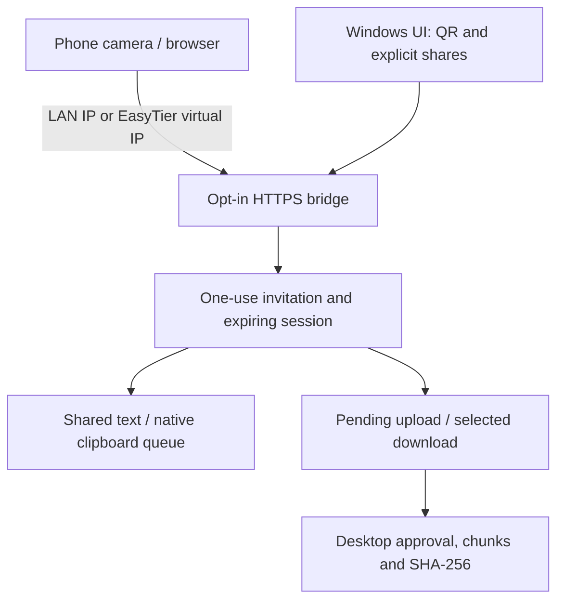

# Mobile web bridge (development preview)

The Windows desktop hosts a self-contained mobile HTML page over a separately
opted-in HTTPS listener. Phones use either the same LAN or their own externally
configured EasyTier client. No discovery broadcasts, NAT traversal, cloud relay,
mobile VPN integration or native mobile client is introduced.

## HTTP protocol v1

The `/api` paths in this first bridge version are v1. Incompatible future changes
must use new paths or explicit version negotiation. API JSON is limited to
1 MiB + 4 KiB; binary chunks are additionally restricted to 256 KiB. No cookies,
CORS allowance, third-party resources or service-worker cache is used. Responses
have no-store, no-referrer, nosniff and a restrictive CSP/frame policy.

| Route | Behavior |
| --- | --- |
| `GET /` | Static mobile page; contains no private board content or invitation. |
| `POST /api/pair` | `{token}`; consumes the QR invitation, returns session bearer and expiry. |
| `POST /api` | Bearer required; tagged `action`: `board`, `text`, `offer`, `task`, `finish`, `cancel`. |
| `POST /api/chunk/{id}/{offset}` | Bearer required; binary body; returns durable acknowledged `offset`. |
| `GET /api/download/{id}` | Bearer required; only explicitly published file IDs, attachment response. |

The QR URL places a cryptographically random 256-bit invitation in the fragment;
it is not sent as a URL query/referrer or server access path. The mobile page
removes the fragment from the current history entry before exchanging it. Bearer
credentials and task metadata live in tab-scoped sessionStorage; private text
is not stored there. Do not share screenshots/URLs containing invitations.

A generated session identity `web-<UUID>` owns its upload tasks. Knowing a task ID
never grants another session permission to inspect, write, finish or cancel it.
Session expiry/revocation is checked again immediately before mutating tasks.
Closing sharing aborts live TLS connections and blocks later mutations. Transfer
offers remain pending until the existing desktop receiver-approval command runs.
The native peer TLS protocol, signing identities and trusted-peer config are not
changed or implicitly populated by web pairing.

## Defaults and recovery

- Disabled by default, no persisted listener setting or automatic re-enable.
- Exact LAN/virtual IP only, independent port (suggested 47832).
- Per-start ephemeral self-signed certificate with IP subjectAltName; displayed
  SHA-256 fingerprint. No automatic certificate trust installation.
- 120-second, single-use invitation; 60-minute sessions; maximum eight sessions.
- 16 live HTTPS connections, 120-second per-connection deadline, four outstanding
  blocking operations. Transfer mutations serialize with revocation.
- Browser file cap 64 MiB; 100 explicitly shared downloads; existing 1,000-task
  ceiling, filename/path validation, no-overwrite and disk-space checks apply.
- Whole browser file buffering is explicitly bounded for WebCrypto SHA-256. This
  cap is separate from the desktop's native streaming transfer limit. No large-file
  or mobile background throughput claims are made.
- Lost chunk response: query `task` to recover the receiver's acknowledged offset
  and resend from it. Duplicate/out-of-order chunks are rejected. `finish` is
  idempotent after success. SHA mismatch leaves staging intact for cancellation.
- Desktop restart/bridge close invalidates browser credentials. Partial uploads
  cannot be resumed from a newly paired session; cancel the old task locally and
  offer a new task. No cross-session recovery authorization is implied.

## Platform limits and validation

Manual text exchange is intentional. WebKit limits Clipboard API access to secure
contexts and user gestures; Android browsers also apply secure-context and
permission policies. The page catches denied/unavailable API calls and supports
manual long-press paste/copy. Native mobile background clipboard capture and
in-page camera scanning are not implemented; scan the desktop QR with the phone's
existing camera/scanner.

Sources consulted 2026-10-28:
- https://webkit.org/blog/10855/async-clipboard-api/
- https://developer.mozilla.org/en-US/docs/Web/API/Clipboard_API
- https://github.com/tokio-rs/axum/blob/main/examples/low-level-rustls/src/main.rs
- https://docs.rs/hyper-util/latest/hyper_util/service/index.html

Real loopback HTTPS tests cover page access, self-signed trust rejection,
one-use/expired QR, expired and revoked sessions, wrong origin, unknown bearer,
explicit/filtered text sharing, cross-session task isolation, receiver approval,
chunk acknowledgement and resume, digest mismatch, cancellation, unsafe filename,
size limit and authenticated downloads. They bypass certificate validation only
in the loopback test client. These are not physical phone/LAN/EasyTier tests.

Outstanding: physical Android/iOS browser testing, accessible certificate-trust
onboarding, trusted-certificate configuration, separately scoped web permissions,
per-device revocation UI, automatic foreground clipboard snapshots (explicit
opt-in design pending), download range resume, native mobile apps and soak tests.
